<p align="center"></p>

<p align="center">
  
  
  
  
  
  
  <a href=".github/workflows/ci.yml"></a>
</p>

<p align="center">
  
</p>

## What it is

**UsVault** is a small, private space for two people. Each of you keeps a daily journal (text and a photo), picks a mood, and sets a live status (*Free*, *Busy*, *Someone Around*). Once you link accounts with a partner code, you see each other's status, today's mood, greetings and little "gossip" notes in real time. Your journal itself stays private to you.

It is a mobile-first React PWA backed by Firebase. Firestore security rules decide who can see what, and a test suite checks those rules.

<p align="center">
  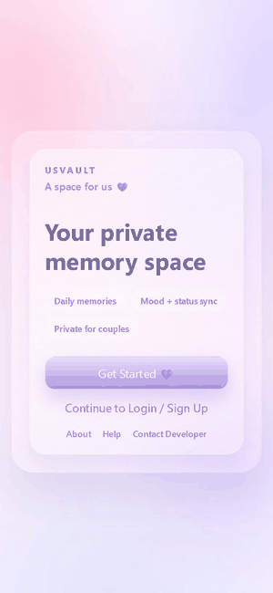
</p>

## Features

| | Feature | What it does |
| --- | --- | --- |
| 🏠 | **Home dashboard** | Greeting written by your partner, today's memory, "On this day" from past years, both statuses, partner's mood today, partner's latest gossip, and an "Open when you miss me" button |
| 📔 | **Memory journal** | One entry per day with text (up to 2,500 characters) and an optional photo. Timeline view, edit past days, delete with undo |
| 😊 | **Mood tracker** | Pick one of six moods for today; history list. Your partner sees today's mood on their dashboard |
| 🟢 | **Live status** | Free / Busy / Someone Around, synced in real time. The app's colour theme follows your partner's status |
| 🔗 | **Partner linking** | Share your random code (`UV-XXXXXX-XXXXXX`); your partner enters it once and the two accounts are linked |
| 🔔 | **Notifications** | In-app alert feed (mark all read, delete, clear all) whenever your partner updates something. Background web push through a Cloud Function and FCM |
| ✨ | **Vibes** | Date Dice (random pick from your saved date ideas, can be saved into today's memory), Gossip Zone (shared with your partner), Quick Notes. Date ideas and quick notes are stored only on your device |
| 👤 | **Profile** | Your name, what you call your partner, profile photo, partner code |
| 🛡️ | **Admin dashboard** | For admin accounts: list users, restrict or ban access with a reason, delete a user's app data |
| 📲 | **PWA** | Installable, offline app shell, cached images, Firestore offline cache, daily reminder |
| 🔒 | **Optional strict mode** | Limit sign-ups to an allowlist of emails (`VITE_STRICT_COUPLE_MODE`) |

## Screenshots

<p align="center">
  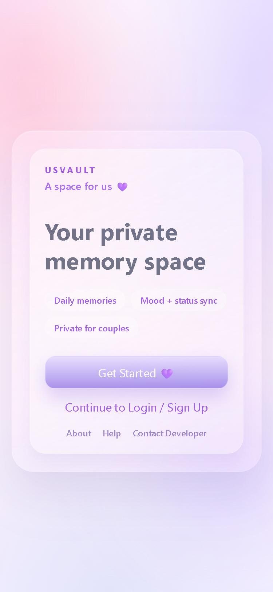
  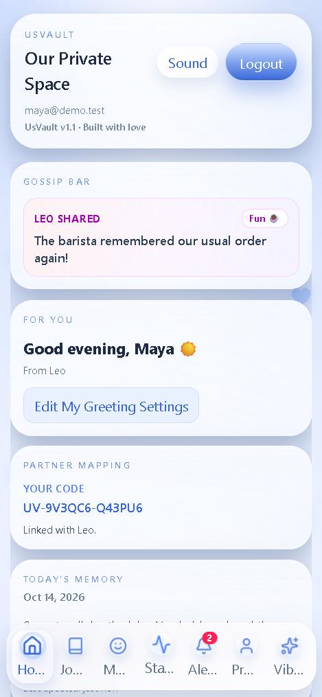
  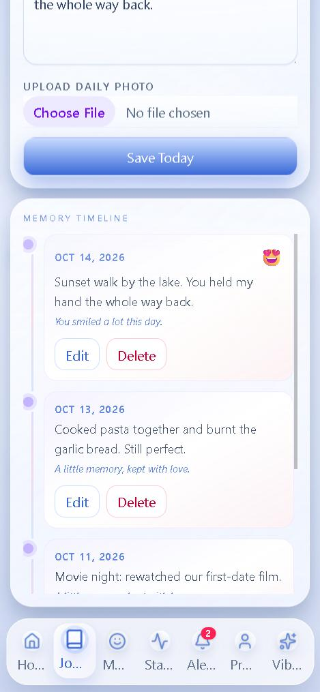
  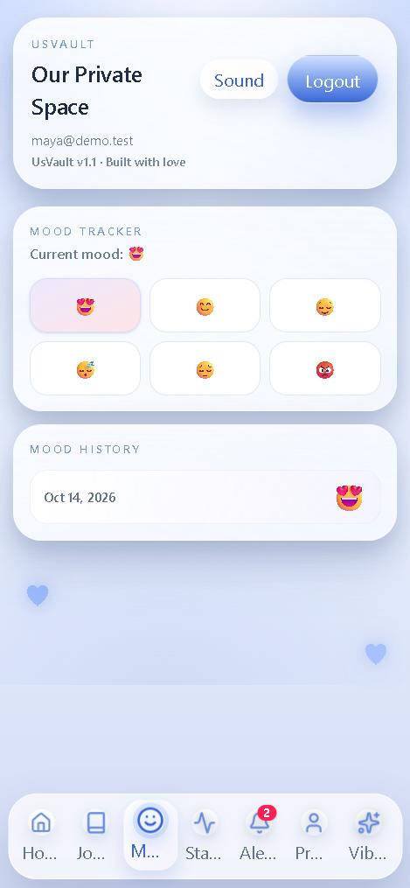
</p>
<p align="center">
  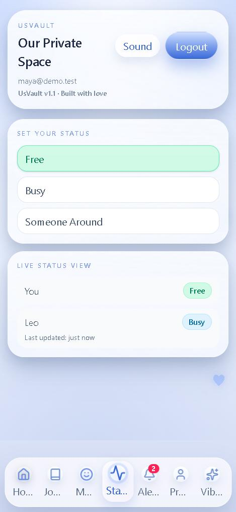
  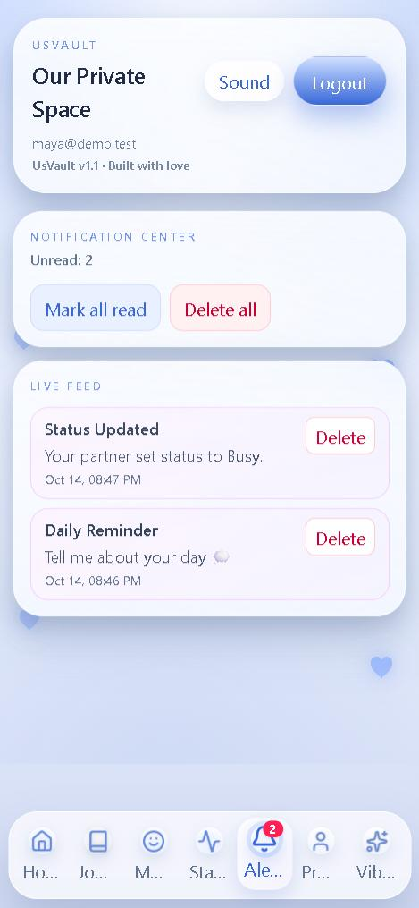
  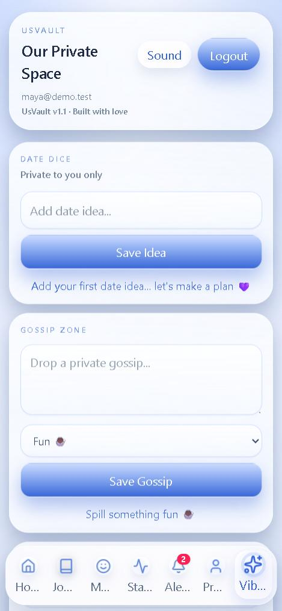
  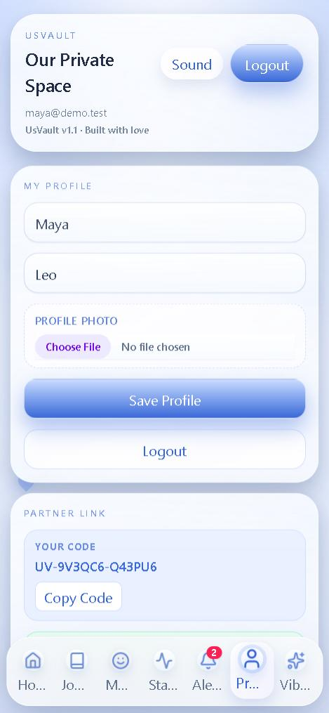
</p>

<sub>All screenshots use made-up demo accounts ("Maya" and "Leo") on the local Firebase emulator.</sub>

## How it works

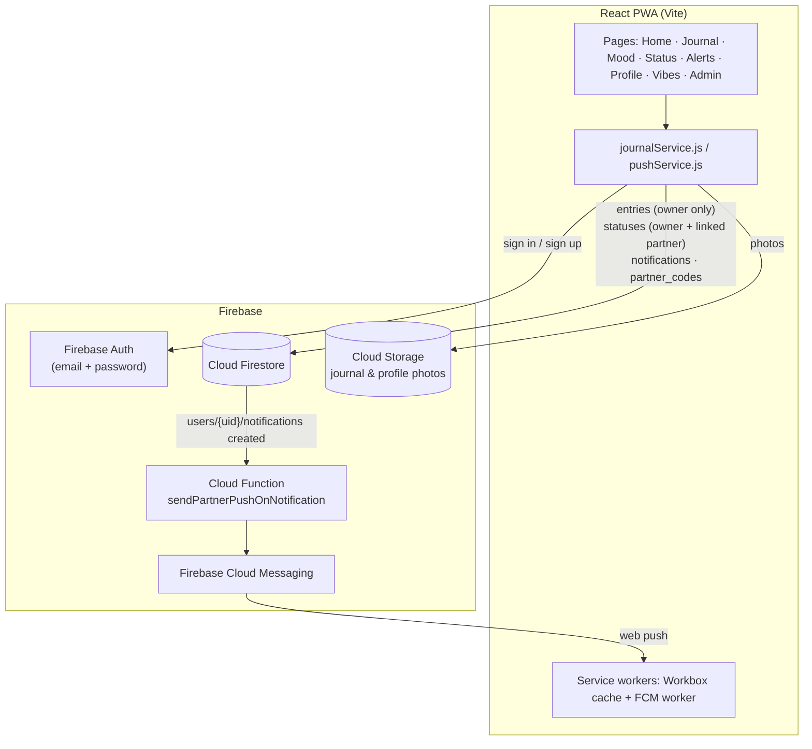

**Who can read what** (enforced in [`firestore.rules`](firestore.rules), tested in [`tests/rules`](tests/rules/firestore.rules.test.js)):

| Data | Owner | Linked partner | Anyone else |
| --- | :---: | :---: | :---: |
| Journal entries `users/{uid}/entries` | read / write | no | no |
| Profile, status, mood, gossip `statuses/{uid}` | read / write | read | no |
| Notifications `users/{uid}/notifications` | read / write | can create | no |
| Partner code lookup `partner_codes/{code}` | create own | single lookup | single lookup, no listing |

Restricted or banned accounts are blocked by the rules too, not just in the UI.

## Quickstart

```bash
git clone https://github.com/ekupekuAI/UsVault.git
cd UsVault
npm install
cp .env.example .env     # then fill in your Firebase web config
npm run dev
```

Open http://localhost:5173. If any Firebase variable is missing, the app shows a **"Firebase is not configured"** screen listing the variables to fill in.

Deploy the security rules (needed for partner linking, partner mood and profile privacy):

```bash
npm run firebase:login
npm run firebase:deploy:rules
npm run firebase:deploy:functions   # optional: background push
```

### Try it without a Firebase project

Needs Java 11+. Runs everything on the local Firebase Emulator Suite (auth `6209`, Firestore `62091`, Storage `62092`):

```bash
npm run emulators    # terminal 1
npm run dev:local    # terminal 2
```

> On some Windows machines the Firestore emulator fails to start with a Java `Invalid argument: connect` error. Setting `JAVA_TOOL_OPTIONS=-Djdk.net.unixdomain.tmpdir=C:/tmp` (any short folder) fixes it.

### Quality checks

```bash
npm run lint
npm run test         # unit tests
npm run test:rules   # Firestore security-rules tests (starts the emulator, needs Java)
npm run build
```

## Environment variables

Copy [`.env.example`](.env.example) to `.env`. Never commit `.env`.

| Variable | Required? | Where to get it |
| --- | :---: | --- |
| `VITE_FIREBASE_API_KEY` | ✅ | Firebase Console → Project settings → General → Your apps → Web app config |
| `VITE_FIREBASE_AUTH_DOMAIN` | ✅ | Same web app config |
| `VITE_FIREBASE_PROJECT_ID` | ✅ | Same web app config |
| `VITE_FIREBASE_STORAGE_BUCKET` | ✅ | Same web app config (often `<project-id>.appspot.com`) |
| `VITE_FIREBASE_MESSAGING_SENDER_ID` | ✅ | Same web app config |
| `VITE_FIREBASE_APP_ID` | ✅ | Same web app config |
| `VITE_FIREBASE_VAPID_KEY` | For push | Firebase Console → Project settings → Cloud Messaging → Web Push certificates |
| `VITE_ADMIN_EMAILS` | Optional | Comma-separated admin emails. Keep in sync with the lists in `firestore.rules` and `storage.rules` |
| `VITE_STRICT_COUPLE_MODE` | Optional | `true` to only allow emails in `VITE_ALLOWED_USERS` |
| `VITE_ALLOWED_USERS` | Optional | Comma-separated allowlist used by strict mode |

Also enable **Email/Password** sign-in in Firebase Console → Authentication → Sign-in method.

<details>
<summary><strong>Project structure</strong></summary>

```text
UsVault/
├── public/
│   ├── firebase-messaging-sw.js   # FCM background worker (config passed in via its URL)
│   └── pwa-192.svg, pwa-512.svg   # PWA icons
├── src/
│   ├── main.jsx                   # boot: setup screen when env is missing, else <App/>
│   ├── App.jsx                    # tabs, realtime subscriptions, partner theme
│   ├── firebase/config.js         # Firebase init + emulator switch
│   ├── context/                   # AuthContext (login, signup, bans), SoundContext
│   ├── services/
│   │   ├── journalService.js      # entries, statuses, partner linking, notifications, admin
│   │   └── pushService.js         # FCM permission + token handling
│   ├── pages/                     # Landing, Auth, Dashboard, MemoryJournal, MoodTracker,
│   │                              # Status, NotificationCenter, Profile, Vibes, AdminDashboard
│   ├── components/                # AppShell, SplashScreen, DailyReminder, ui/, effects/, motion/
│   ├── config/                    # strict-mode allowlist, admin emails
│   ├── constants/                 # status + mood options
│   └── utils/                     # dates, highlights, "on this day", nudges (+ unit tests)
├── functions/index.js             # Cloud Function: push to partner on new notification
├── tests/rules/                   # Firestore security-rules tests (emulator)
├── firestore.rules, storage.rules # access control
├── firebase.json                  # deploy targets + emulator ports
├── .env.example, .env.emulator    # env templates
└── docs/                          # production checklist, README assets
```

</details>

## What's new in this version (v1.1)

| Before (v1.0) | After (v1.1) |
| --- | --- |
| Blank page when `.env` was missing | Clear setup screen listing the missing variables |
| Setting today's mood **erased today's memory** text and photo | Entries are saved field by field, so nothing gets overwritten |
| Partner linking **always failed** (rules rejected the write) | Linking works through `partner_codes/{code}`; rules only accept it when the code really belongs to that user and they aren't linked to someone else |
| Any signed-in user could list **every** profile: emails, partner codes, gossip, messages | Profiles visible only to the owner, the linked partner and admins; partner codes are random and rotated on next login |
| Partner's mood never appeared (journals are owner-only) | Today's mood is shared through the profile; journals stay private |
| Bans only enforced in the UI | Bans enforced in Firestore rules as well |
| New sign-ups could be logged straight back out (duplicate write race) | Account setup de-duplicated and transactional |
| Firebase keys hardcoded in the messaging worker; FCM token printed to the console | Worker reads config from env; token no longer logged |
| Generic "login failed" errors; journal text over 2,500 chars failed silently; `??` in the header | Specific auth messages, character limit in the editor, header fixed |
| No way to test the security rules | 18 rules tests plus a one-command local emulator setup |

## Future development

These are not built yet:

- **Unlinking / re-linking partners:** links are currently permanent.
- **Admin by custom claim only:** the email allowlist fallback in the rules doesn't require a verified email.
- **Sync for Date Dice ideas and Quick Notes:** today they live in the browser's local storage only.
- **Clean up the unused Next.js scaffold** at the repo root (`app/`, `components/`, `hooks/`, `lib/`, `styles/`). It is not part of the Vite build.

See [docs/PRODUCTION_CHECKLIST.md](docs/PRODUCTION_CHECKLIST.md) before going live.

<p align="center"><sub>Made with 💜 for two.</sub></p>
